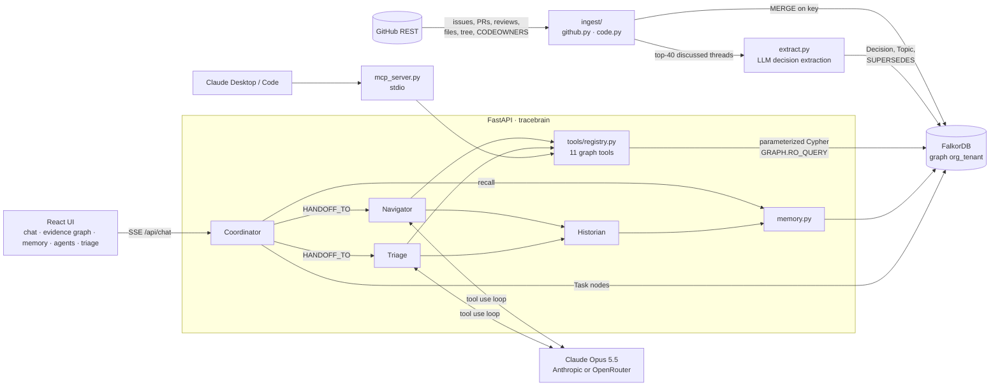

# TraceBrain

**A company brain for engineering teams, built on FalkorDB: every answer comes with the graph path that produced it.**


TraceBrain loads a GitHub org into a FalkorDB graph: people, repos, modules, files, Python imports, issues, PRs, reviews, comments, CODEOWNERS, and engineering *decisions* that an LLM extracts from discussion threads. A small team of agents works on that graph. They answer "who knows X", "why was Y decided" and "what breaks if Z changes". They triage new issues: owner, two reviewers, blast radius, likely duplicates and a draft comment. They also remember each user across sessions. Every tool call returns the Cypher it ran plus the nodes and edges it touched, and the UI draws that as an evidence graph next to the answer.

Graph Hacks (FalkorDB) entry. Demo tenant: `FalkorDB/GraphRAG-SDK`, `FalkorDB/falkordb-py`, `FalkorDB/QueryWeaver`.

- Live demo: `TODO: live URL`
- Video (3 min): `TODO: video URL`
- Blog post: `TODO: blog URL`
- Deeper design: [docs/architecture.md](docs/architecture.md)

---

## What it does

| Ask | What happens in the graph |
|---|---|
| *Who knows the Cypher generation code?* | `find_experts` resolves the topic to files and discussions, then scores people over `AUTHORED → PR → MODIFIES → File`, `REVIEWED`, `OWNS`, `COMMENTED_ON` and `MADE → Decision` paths with a 180-day recency half-life. It returns a per-person score breakdown and the evidence paths behind each score. |
| *What breaks if `falkordb/graph.py` changes?* | `blast_radius` walks `IMPORTS` edges in reverse up to 3 hops, then collects the affected modules, CODEOWNERS owners, recent modifiers and the decisions that `AFFECTS` those files. |
| *Why did GraphRAG-SDK switch its LLM abstraction?* | `trace_decision` finds `Decision` nodes through the full-text index, follows `DECIDED_IN` to the source issue/PR, `MADE` to the people involved, and the `SUPERSEDES` chain. If nothing matches, it falls back to the closest discussions. |
| *Triage: https://github.com/FalkorDB/GraphRAG-SDK/issues/274* | The Triage agent fetches the issue (read-only) and runs related-work, file search, blast-radius and expert tools. It submits a structured plan (assignee, two reviewers, duplicates, labels, priority, draft comment). It never posts to GitHub on its own. |
| *(next session)* "same format as last time" | The Coordinator recalls the user's `Fact`s and recent `Episode`s from the graph before routing. The Historian writes new facts after the turn and supersedes contradicted ones. |

## How it maps to the tracks

**Track 1: Agents That Act on Connected Data**
- Multi-hop graph tools: expert scoring over 2-hop evidence paths, reverse-`IMPORTS` blast radius up to 6 hops, undirected `shortest_path` up to 6 hops, `SUPERSEDES` chains.
- Graph algorithms as agent tools: `centrality` calls FalkorDB `algo.pageRank` (File→`IMPORTS`, Issue/PR→`REFERENCES` projections) and `algo.betweenness`, and falls back to degree when the scores are flat.
- The same 11-tool registry runs both the agents' Anthropic tool definitions and an MCP server, so Claude Desktop/Code choose from identical tools.
- Acts on what the graph shows: the Triage agent produces an assignee, reviewers, labels and a draft GitHub comment. Posting it is a separate API action, gated behind `TRACEBRAIN_ALLOW_GITHUB_WRITE=1`.
- Explainable: every tool returns `{data, trace: {cypher, nodes, edges}}`. Answers cite nodes inline as `[[key]]`, and those citations render as clickable chips that focus the node in the evidence graph.

**Track 2: Agent Memory and Coordination**
- Episodic memory: `(User)-[:HAD]->(Session)-[:CONTAINS]->(Episode)`, a per-user `NEXT` timeline, and `CITED` edges from each episode to the org nodes it used.
- Semantic, preference and procedural memory: `(User)-[:KNOWS]->(Fact {kind})-[:ABOUT]->(any org node)`, with `LEARNED_FROM` pointing back to the source episode.
- Supersession: a contradicting fact sets `valid=false` on the old one and adds `(new)-[:SUPERSEDES]->(old)`, so history is kept and recall ignores stale facts.
- Shared state and handoffs: each chat turn is a task tree in the graph, `chat → navigate|triage → remember`, linked by `HANDOFF_TO`, claimed by `Agent` nodes, with `TOUCHED` edges to everything a task used. The Agents tab is a view over those nodes.
- Isolation: one FalkorDB graph per tenant (`org_<tenant>`). Inside a tenant, every memory query is anchored on the caller's `User` node, and the `user_id` comes from the request context, never from the LLM.

**Track 3: Company Brain**
- Code, issues, PRs, reviews, comments, CODEOWNERS and decisions live in one graph.
- Who owns and who knows what: `OWNS` from CODEOWNERS plus activity-based expertise with an explicit score breakdown.
- Decisions traced to their source: `Decision {summary, rationale, status, quote, source_url}` linked by `DECIDED_IN` to the thread, `MADE {role}` to people, `AFFECTS` to files/modules and `ABOUT` to topics.
- Kept current: incremental sync with a `SyncState` node per repo (GitHub `since=`). Every write is a `MERGE` on `key`, so re-syncing is idempotent, and threads are only re-sent to the LLM when they changed after the last extraction.
- Answers with sources: inline citations resolve to nodes with GitHub URLs.

## Architecture



- **Ingest** (`backend/tracebrain/ingest`): an async GitHub client with rate-limit handling and pagination. It fetches issues/PRs, then per-PR files, reviews and comments. Code ingest parses up to 400 `.py` files per repo with `ast` and resolves imports to repo files. CODEOWNERS rules map to `OWNS` edges.
- **Tools** (`backend/tracebrain/tools`): plain functions `fn(graph, **args) -> {data, trace}`. They are registered once and exposed to the agents and over MCP.
- **Agents** (`backend/tracebrain/agents`): a manual streaming tool-use loop on the Anthropic SDK with adaptive thinking, prompt caching on system + tools, and parallel tool calls. Coordinator, Navigator, Triage and Historian.
- **Web** (`web/`): Vite + React + `react-force-graph-2d`. Chat with a per-answer step timeline, an evidence graph that accumulates `subgraph` events, and tabs for Memory, Agents and Triage.

More detail, with the actual Cypher: [docs/architecture.md](docs/architecture.md).

## Graph schema at a glance

```
(Person)-[:AUTHORED]->(Issue|PullRequest)        (Person)-[:REVIEWED {state, at}]->(PullRequest)
(Person)-[:COMMENTED_ON {count, last_at}]->(Issue|PullRequest)
(PullRequest)-[:MODIFIES {additions, deletions}]->(File)-[:IN_MODULE]->(Module)-[:IN_REPO]->(Repo)
(File)-[:IMPORTS]->(File)                        (Person)-[:OWNS]->(Module|File)        # CODEOWNERS
(PullRequest)-[:CLOSES]->(Issue)                 (Issue|PullRequest)-[:REFERENCES]->(Issue|PullRequest)
(Issue|PullRequest)-[:HAS_LABEL]->(Label)        (Issue|PullRequest|Decision)-[:ABOUT]->(Topic)
(Decision)-[:DECIDED_IN]->(Issue|PullRequest)    (Person)-[:MADE {role}]->(Decision)
(Decision)-[:AFFECTS]->(Module|File)             (Decision)-[:SUPERSEDES]->(Decision)

# memory                                           # coordination
(User)-[:HAD]->(Session)-[:CONTAINS]->(Episode)   (Agent)-[:CLAIMED]->(Task)-[:FOR]->(Session)
(Episode)-[:NEXT]->(Episode), -[:CITED]->(any)    (Task)-[:HANDOFF_TO]->(Task)
(User)-[:KNOWS]->(Fact)-[:ABOUT]->(any)           (Task)-[:TOUCHED]->(any)
(Fact)-[:SUPERSEDES]->(Fact), -[:LEARNED_FROM]->(Episode)
```

Every node has a unique string `key` (`person:<login>`, `file:<owner>/<repo>:<path>`, `pr:<owner>/<repo>#<n>`, ...) with a range index. Full-text indexes cover Issue/PR title+body, Decision summary+rationale, File path, Topic name, Person login+name and Fact text.

## Quickstart (local, no Docker)

Requirements: Python 3.12+ (developed on 3.14), Node 20.19+ (or 22.12+), and an Anthropic or OpenRouter key for the agents. A GitHub token is only needed to ingest.

```bash
git clone https://github.com/The-MathKing/tracebrain.git && cd tracebrain
python3 -m venv .venv && source .venv/bin/activate
pip install -e './backend[lite]'  # `lite` = embedded FalkorDB (falkordblite); add `,dev` for pytest

cat > .env <<'EOF2'
ANTHROPIC_API_KEY=sk-ant-...      # or OPENROUTER_API_KEY=sk-or-... (Anthropic-compatible endpoint)
GITHUB_TOKEN=ghp_...              # optional locally: falls back to `gh auth token`
# FALKORDB_URL=redis://localhost:6379   # unset = embedded falkordblite at data/falkordb.db
# TRACEBRAIN_TENANT=falkordb            # graph name becomes org_<tenant>
# TRACEBRAIN_MODEL=claude-opus-5-5      # default (anthropic/claude-opus-5.5 via OpenRouter)
EOF2

# 1a. Build the graph from GitHub (re-run any time; it syncs incrementally from SyncState)
tracebrain-ingest FalkorDB/GraphRAG-SDK FalkorDB/falkordb-py FalkorDB/QueryWeaver
#    flags: --full  --max-items 300  --no-code  --no-decisions  --tenant T
# 1b. ...or load the bundled demo snapshot instead (no GitHub token, no extraction cost)
make seed-import

# 2. API on :8000
uvicorn tracebrain.api:app --port 8000

# 3. Web on :5173 (proxies /api to :8000)
cd web && npm install && npm run dev
```

Open http://localhost:5173 and click one of the example prompts.

- **One port instead of two:** `make build && make serve` builds the UI into `web/dist`, and the API serves it at http://localhost:8000.
- **Without an LLM key**, ingest still builds the whole structural graph and skips decision extraction. The graph endpoints work, and chat returns a clear `LLM not configured` error.
- **Without the backend**, `make mock` (or `npm run mock` in `web/`) serves fake data on :8000 for the UI.
- **Tests:** `make test`. They use throwaway `test_<uuid>` graphs and a fake LLM client.
- `make help` lists all targets: `install`, `dev-api`, `dev-web`, `mock`, `build`, `serve`, `test`, `seed-export`, `seed-import`, `docker`.

**Docker / live deploy:** `make docker` (`docker compose up --build`) runs FalkorDB plus the app. The app is on :8000 and FalkorDB Browser on :3000, and the app seeds itself from the snapshot on first boot. The hosted path (FalkorDB Cloud + Render via `render.yaml`) is written up step by step in [deploy/DEPLOY.md](deploy/DEPLOY.md).

## Use it from Claude Desktop / Claude Code (MCP)

`tracebrain-mcp` is a stdio MCP server that exposes the same 11 tools the agents use (`search_entities`, `get_neighbors`, `find_experts`, `trace_decision`, `blast_radius`, `find_related_work`, `shortest_path`, `centrality`, `run_cypher`, `recall`, `remember`). Each result includes its `trace` (Cypher + nodes + edges).

Claude Desktop (`claude_desktop_config.json`):

```json
{
  "mcpServers": {
    "tracebrain": {
      "command": "/absolute/path/to/tracebrain/.venv/bin/tracebrain-mcp",
      "env": {
        "TRACEBRAIN_TENANT": "falkordb",
        "TRACEBRAIN_USER": "aryan",
        "FALKORDB_URL": "redis://localhost:6379"
      }
    }
  }
}
```

Claude Code:

```bash
claude mcp add tracebrain -e TRACEBRAIN_TENANT=falkordb -e TRACEBRAIN_USER=aryan -- /absolute/path/.venv/bin/tracebrain-mcp
```

`TRACEBRAIN_USER` is the default `user_id` for `recall`/`remember`. Leave `FALKORDB_URL` out to use the embedded database at `data/falkordb.db`. A FalkorDB server is the safer choice when the API and the MCP server run at the same time.

## HTTP API

All routes are under `/api` (FastAPI, port 8000). Node keys contain `/ # :`, so URL-encode them.

| Method & path | Returns |
|---|---|
| `POST /api/chat` `{user_id, session_id?, message}` | `text/event-stream` of JSON events: `task`, `step` (agent, tool, input, summary, cypher), `subgraph` (nodes, edges, highlight), `token`, `answer` (text, citations), `triage` (plan), `memory` (written, recalled), `error`, `done` (session_id) |
| `GET /api/graph/node/{key}?depth=1&limit=80` | `{nodes, edges, center}` neighborhood |
| `GET /api/graph/overview` | `{tenant, counts, top_people, recent_decisions, repos}` |
| `GET /api/memory/{user_id}` | `{facts, episodes, sessions}` (facts include `valid`, `supersedes`, `about`) |
| `DELETE /api/memory/{user_id}/facts/{key}` | forget one fact (scoped to that user) |
| `GET /api/tasks?limit=50` | task board: `[{key, kind, status, agent, input, output, handoffs, session, ...}]` |
| `POST /api/triage/{task_key}/post` | posts the draft comment to GitHub. Returns 403 unless `TRACEBRAIN_ALLOW_GITHUB_WRITE=1`, 409 if already posted |
| `POST /api/ingest` `{repo, since?}` → `GET /api/ingest/{job_id}` | background sync job: `{status, counts, log}` |
| `GET /api/health` | `{ok, falkordb, llm_configured, tenant, model, github_write}` |

Quick check:

```bash
curl -sN -X POST localhost:8000/api/chat -H 'content-type: application/json' \
  -d '{"user_id":"demo","message":"What breaks if falkordb/graph.py changes?"}'
```

## Tech stack

- **FalkorDB**: the only datastore. It holds the org graph, agent memory and the task board. Embedded via `falkordblite` locally, or a FalkorDB server via `FALKORDB_URL`. The code uses range and full-text indexes, `algo.pageRank`, `algo.betweenness`, `shortestPath` and `GRAPH.RO_QUERY`.
- **Python**: FastAPI, `falkordb` client, `httpx` (async GitHub client), the `mcp` SDK, `ast` for import resolution.
- **LLM**: Anthropic Python SDK with Claude Opus 5.5 (adaptive thinking, prompt caching, strict tool schemas). It works against Anthropic directly or OpenRouter's Anthropic-compatible endpoint, and drops optional request features if an endpoint rejects them.
- **Web**: Vite, React 19, TypeScript, `react-force-graph-2d`.

## Limitations

- GitHub is the only source. There are no Slack, docs or wiki connectors yet.
- Import edges exist only for Python (up to 400 files per repo). Other languages get `File`/`Module` nodes but no `IMPORTS`.
- Ingest covers the 300 most recently updated issues/PRs per repo by default (`--max-items`). Decision extraction reads the 40 most-discussed threads per sync, and a thread is only re-read after it changes.
- Decisions and fact supersession come from the LLM. They cite a quote and a source URL, but they can be wrong or incomplete.
- Duplicate detection uses lexical matching (full-text score plus Jaccard term overlap). It does not use embeddings.
- One tenant per API process (`TRACEBRAIN_TENANT`). The per-tenant graphs are isolated, but there is no auth layer: `user_id` is whatever the client sends.
- The UI shows each step's summary and the evidence graph. The raw Cypher is in the SSE `step` events and the MCP `trace`, but the timeline does not render it yet.

## License

MIT, see [LICENSE](LICENSE).
